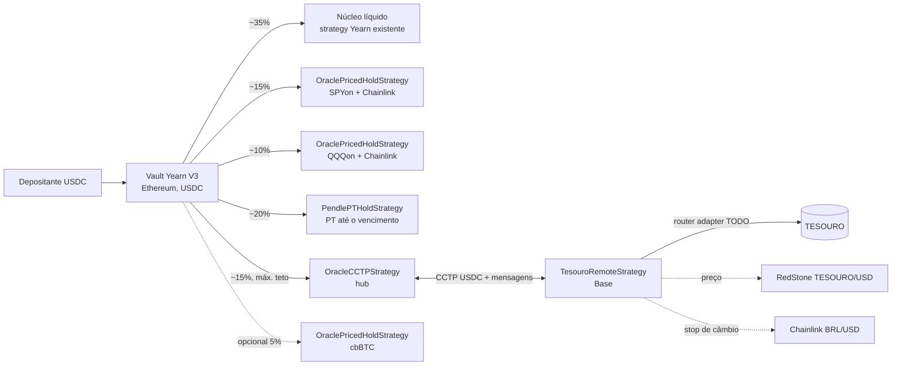
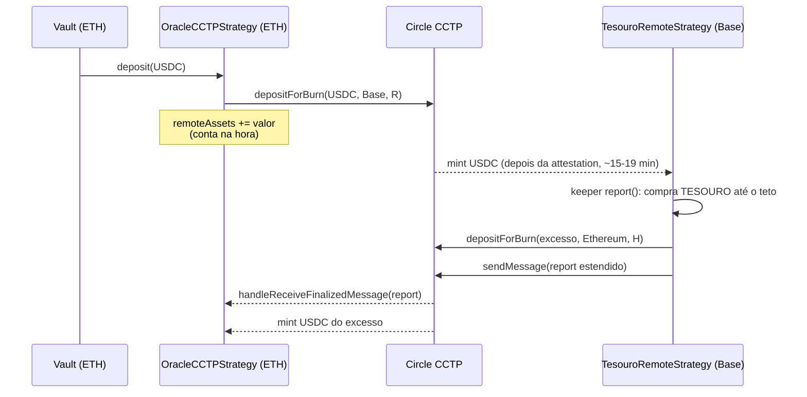
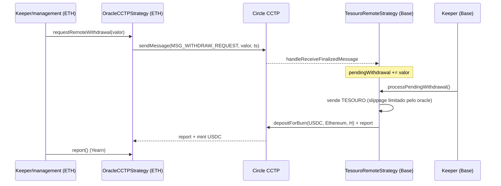

# Hub em USD na Ethereum com teto de TESOURO na Base

Este documento descreve a branch `feat/usd-hub-tesouro-ceiling`. A ideia é um vault Yearn V3 na Ethereum que recebe **USDC**, parecido com o yvUSD, e distribui o dinheiro entre sleeves:

- **TESOURO na Base**, via CCTP, com teto fixo em dólar;
- **SPYon e QQQon (Ondo)** na própria Ethereum;
- **um PT da Pendle** segurado até o vencimento;
- **um núcleo líquido em USD** (uma strategy Yearn que já existe, como sUSDS ou Morpho OG).

Nada foi deployado. Os scripts só foram simulados (`forge script` sem `--broadcast`).

## Arquitetura



| Contrato | Rede | O que faz |
|---|---|---|
| `src/origin/OracleCCTPStrategy.sol` | Ethereum | Estende `CCTPStrategy`. Aceita o report estendido, rejeita report velho, compara o preço com um oracle no hub (opcional), manda pedido de saque pra Base, loss limit padrão de 3%, teto de exposição no hub (`maxRemoteExposure`). |
| `src/remote/BaseOracleRemoteStrategy.sol` | Base | Base para sleeves remotas com ativo precificado (não ERC-4626). Troca USDC pelo ativo num router, valoriza pelo oracle, manda o report estendido, recebe pedidos de saque do hub. |
| `src/remote/TesouroRemoteStrategy.sol` | Base | TESOURO com teto em dólar (`maxUsdExposure`, padrão 75.000 USDC) e stop de câmbio BRL/USD. |
| `src/remote/TesouroRemoteStrategyFactory.sol` | Base | Deploy por CREATE3, no mesmo padrão do `RemoteStrategyFactory`, só que restrito à governance. |
| `src/local/OraclePricedHoldStrategy.sol` | Ethereum | Compra e segura um token (SPYon, QQQon, cbBTC) com USDC e valoriza pelo feed, com checagem de preço velho. |
| `src/local/PendlePTHoldStrategy.sol` | Ethereum | Compra um PT com USDC e segura até o vencimento, usando o `PendleSwapper` do periphery da Yearn e o oracle PY da Pendle. Sem loop e sem empréstimo. |

O núcleo líquido não tem código novo. É uma strategy Yearn que já existe, adicionada ao vault (`LIQUID_CORE_STRATEGY` no `DeployHub`).

Nada aqui depende de "o hub é a Ethereum, domain 0" além do que o repo já assumia. O hub é a Ethereum, então isso continua valendo.

## Fluxos

### Depósito e bridge



### Report estendido (Base → Ethereum)

O payload é `abi.encode(totalAssets, timestamp, price, oracleUpdatedAt)`, com 128 bytes. O hub:

1. confere transmitter, domain, remetente e finalidade (o mesmo que o `CCTPStrategy` original);
2. recusa payload que não tenha 128 bytes (o formato antigo, de 64 bytes, é recusado de propósito);
3. recusa `price == 0`, `oracleUpdatedAt > timestamp`, `timestamp` mais velho que `maxReportAge` (padrão 1 dia) e `oracleUpdatedAt` mais velho que `maxOracleAge` (padrão 26 h, porque o feed RedStone tem heartbeat de 24 h);
4. se `hubPriceOracle` estiver configurado, recusa quando a diferença passa de `maxPriceDeviationBps` (padrão 2%);
5. aplica a mesma marca d'água de timestamp do repo original.

Quando recusa, a transação reverte. O nonce do CCTP não é consumido, e um report mais novo substitui o antigo.

### Pedido de saque (Ethereum → Base)



Enquanto há pedido pendente, `report()` na Base não compra TESOURO com o USDC reservado. A governance pode zerar o pedido com `clearPendingWithdrawal()`.

## Teto em dólar

- `maxUsdExposure` fica em unidades de USDC (6 casas). O padrão é `75_000e6` e a governance pode mudar.
- A compra é limitada a `maxUsdExposure - valorAtual`. O valor comprado sai igual ou menor que o USDC gasto, por causa do slippage, então a compra nunca passa do teto.
- O USDC parado que não cabe no teto volta pro hub no `report()` e no `tend()`. Na mesma transação vai um report novo, para o hub não contar duas vezes.
- Se o preço sobe (ou o teto é reduzido) e a posição passa de `teto × (1 + ceilingBufferBps)` (buffer padrão de 2%), `tendTrigger()` fica `true` e `tend()` vende o excedente e manda de volta.
- No hub, `setMaxRemoteExposure(teto)` limita `availableDepositLimit`, e o `DeployHub` também coloca o `max_debt` do vault nesse valor. Assim nem chega a ir USDC a mais pra Base.
- Sem router configurado, a sleeve segura USDC até o teto e devolve o resto.

## Stop de câmbio

- `FX_ORACLE` é o Chainlink BRL/USD na Base. Com endereço zero, o stop fica desligado.
- `fxReferencePrice` é gravado no deploy. A governance pode resetar com `resetFxReference()`.
- `fxStopTriggered()` fica `true` quando o BRL/USD cai **mais** que `fxStopBps` (padrão 10%) em relação à referência. Se o feed estiver velho (mais que `fxMaxStaleness`, padrão 2 h, já que o heartbeat é 1 h), retorna `false`.
- Com o stop acionado, **qualquer pessoa** pode chamar `fxUnwind()`. A função vende TESOURO em lotes de até `fxUnwindChunk` (o pool é raso), manda o USDC pro hub, envia o report e marca `fxStopped = true`. Depois disso a função continua liberada até terminar a venda, mesmo que o câmbio se recupere.
- Com `fxStopped`, a sleeve não compra mais nada e devolve todo USDC que chegar. Para voltar ao normal, a governance chama `resetFxStop()`, que também ancora a referência no preço atual. A governance também pode acionar o stop na mão com `setFxStopped(true)`.

## Papéis, keepers e relayer

| Papel | Onde | Faz |
|---|---|---|
| Management (TokenizedStrategy) | Ethereum | Parâmetros do hub (`setReportParams`, `setHubPriceOracle`, `setMaxRemoteExposure`, `setLossLimitRatio`) e das strategies locais (router, slippage, staleness). |
| Keeper (TokenizedStrategy) | Ethereum | `report()`/`tend()` das strategies, `requestRemoteWithdrawal`. |
| Governance (remota) | Base | Teto, router, slippage, staleness, parâmetros de câmbio, `resetFxStop`, `rescue`. |
| Keeper (remoto) | Base | `report()`, `tend()`, `processWithdrawal`/`processPendingWithdrawal`, `pushFunds`/`pullFunds`. |
| Qualquer pessoa | Base | `fxUnwind()`, só quando o stop está acionado ou já armado. |
| **Relayer** | as duas | **Não existe no repo.** Alguém precisa buscar a attestation na API da Circle (Iris) e chamar `MessageTransmitterV2.receiveMessage` na rede de destino, tanto para o mint de USDC quanto para as mensagens (report e pedido de saque). Sem isso nada chega. Pode ser um bot próprio ou um serviço de relay de CCTP. |

## Pesos sugeridos

| Sleeve | Alvo | Observação |
|---|---|---|
| Núcleo líquido (sUSDS / Morpho OG) | 35% | Paga saque na hora, já que o CCTP leva 15–19 min por perna. |
| SPYon | 15% | |
| QQQon | 10% | |
| PT Pendle | 20% | Não pode passar do que o mercado aguenta. Use `PT_MAX_DEBT`. |
| TESOURO (Base) | 15% | Limitado pelo teto em dólar. Com teto de $75k, passa a ser menos de 15% quando o vault cresce. |
| cbBTC (opcional) | 5% | `CBBTC` + `CBBTC_USD_FEED`. |

Esses alvos estão em `script/DeployHub.s.sol` e só são aplicados se `DEBT_ALLOCATOR` for passado. Para isso, o broadcaster precisa ser manager do allocator, e o vault já precisa estar configurado nele.

## Riscos

- **Câmbio BRL.** O TESOURO rende em reais. Uma queda de 10% do real come mais ou menos um ano de cupom. O stop limita a perda, mas não protege contra um gap entre dois updates.
- **Liquidez do TESOURO na Base.** O pool na Curve tem uns $73k, e o supply na Base gira em torno de $24k (cerca de 96k tokens, a ~$0,25). Por isso existe o teto, os lotes no `fxUnwind` e o slippage máximo de 10%. Uma saída grande pode levar vários blocos ou dias.
- **Rota de swap não verificada.** A ideia é Curve TESOURO/BRZ e depois BRZ→USDC, mas nenhum pool foi confirmado. O router é um adapter `IOracleSwapRouter` que **ainda precisa ser escrito e auditado**.
- **Oracle de fonte única.** O preço do TESOURO vem só da RedStone (relayer push, desvio de 0,1%, heartbeat de 24 h). O hub aceita um segundo oracle (`setHubPriceOracle`), mas hoje não existe feed TESOURO/USD na Ethereum. Dá pra montar um adapter BRL/USD × TESOURO/BRL.
- **Horário de mercado das ações.** Os feeds SPYon/QQQon são 24/5 com heartbeat de 24 h. No fim de semana o feed fica velho: depósito fecha, saque fica limitado ao USDC parado e `report()` reverte. Isso evita entrar e sair a preço congelado, mas o gap de segunda-feira aparece de uma vez no report.
- **Restrições dos tokens.** Os tokens Ondo Global Markets têm regras de KYC/jurisdição para mint/redeem e podem ter bloqueio de transferência. O TESOURO (Etherfuse) também tem regras de emissor. Confirme se o vault e as strategies podem segurar esses tokens.
- **USDC = USD.** Toda a valorização assume 1 USDC = 1 USD.
- **PT.** O `PendlePTHoldStrategy` assume que o ativo contábil do SY é USD 1:1 com USDC e só aceita mercado cujo SY recebe e devolve USDC direto. O oracle da Pendle precisa estar com cardinalidade suficiente para o TWAP (`getOracleState`).
- **Contabilidade cross-chain.** É a mesma janela do repo original: entre o mint de USDC e a chegada do report, o hub pode contar o mesmo valor dois lados ou nenhum. O health check (lucro 10%, perda 3%) segura distorções grandes.
- **Código não auditado.** Os testes são unitários com mocks, mais checagens em fork só dos endereços. Não houve teste de integração com CCTP real.

## Endereços

### Verificados (on-chain via `cast` em 08/10/2026, mais a fonte citada)

| Item | Endereço | Fonte |
|---|---|---|
| TESOURO (Base), 6 casas | `0x7ceE47e7B7CD04CF984e8Dd86C42595B5771A9B2` | `name()` = "Etherfuse TESOURO", `decimals()` = 6 |
| RedStone TESOURO/USD (Base), 8 casas | `0xb67047eDF6204F4C81333248dA71F8387050790C` | `description()` = "RedStone Price Feed for TESOURO". redstone-oracles-monorepo `relayer-manifests-multi-feed/baseMultiFeed.json` (heartbeat de 24 h, desvio de 0,1%). Obs.: o mesmo endereço é o feed de BTC na Katana. |
| Chainlink BRL/USD (Base), 8 casas | `0x0b0E64c05083FdF9ED7C5D3d8262c4216eFc9394` | data.chain.link/feeds/base/base/brl-usd, `description()` = "BRL / USD", heartbeat de 1 h |
| SPYon (Ethereum), 18 casas | `0xFeDC5f4a6c38211c1338aa411018DFAf26612c08` | `name()` = "SPDR S&P 500 ETF (Ondo Tokenized)" |
| QQQon (Ethereum), 18 casas | `0x0e397938C1Aa0680954093495B70A9F5e2249aBa` | `name()` = "Invesco QQQ (Ondo Tokenized)" |
| Chainlink SPYon/USD (Ondo API) | `0x6EcC1b902dB35eAFE95332443802774Fd1D72576` | diretório de feeds da Chainlink (`spyon-usd-shared-svr`), 24/5, heartbeat de 24 h |
| Chainlink QQQon/USD (Ondo API) | `0xE5DF423251c67D85B2D70787Af76069d96BC4D4C` | diretório de feeds da Chainlink (`qqqon-usd-shared-svr`), 24/5, heartbeat de 24 h |
| Pendle Router V4 | `0x888888888889758F76e7103c6CbF23ABbF58F946` | pendle-core-v2-public `deployments/1-core.json` |
| Pendle pyYtLpOracle | `0x5542be50420E88dd7D5B4a3D488FA6ED82F6DAc2` | pendle-core-v2-public `deployments/1-core.json` |
| Yearn VaultFactory 3.0.4 | `0x770D0d1Fb036483Ed4AbB6d53c1C88fb277D812F` | `TokenizedStrategy.FACTORY()`, `apiVersion()` = "3.0.4" |
| CCTP, USDC, domains | `src/libraries/CCTPHelpers.sol` | já estavam no repo |

Todos estão em `src/libraries/TesouroAddresses.sol`. Os contratos recebem tudo por argumento de construtor, e os scripts usam esses valores como padrão, que pode ser trocado por env.

### TODO / placeholders

| O que | Onde | Situação |
|---|---|---|
| Router TESOURO↔USDC na Base | `TESOURO_SWAP_ROUTER` / `setRouter` | **Não existe.** Precisa de um adapter `IOracleSwapRouter` para Curve TESOURO/BRZ e BRZ→USDC. Com zero, a sleeve segura USDC. |
| Router das ações na Ethereum | `EQUITY_ROUTER` / `setRouter` | **Não existe.** Adapter Uniswap ou mint/redeem da Ondo. Com zero, segura USDC. |
| Mercado PT | `PENDLE_MARKET` | Escolher um mercado cujo SY aceite USDC direto e que seja denominado em USD. Sem isso, o PT fica de fora. |
| Strategy do núcleo líquido | `LIQUID_CORE_STRATEGY` | Endereço de uma strategy Yearn existente (sUSDS / Morpho OG). |
| Oracle TESOURO/USD no hub | `setHubPriceOracle` | Opcional. Não existe na Ethereum, então precisa de um adapter. |
| cbBTC + feed | `CBBTC`, `CBBTC_USD_FEED` | Opcional. |
| Debt allocator | `DEBT_ALLOCATOR` | Opcional. Sem ele, os pesos são aplicados na mão. |
| Papéis | `SENDER`, `MANAGEMENT`, `KEEPER`, `EMERGENCY_ADMIN`, `PERFORMANCE_FEE_RECIPIENT`, `ROLE_MANAGER`, `REMOTE_GOVERNANCE`, `REMOTE_KEEPER` | Preencher. |
| Relayer CCTP | — | Precisa ser montado (ver acima). |

## Deploy (ainda não executado)

1. **Base:** `forge script script/DeployRemoteBase.s.sol --sig "deployFactory()" --rpc-url $BASE_RPC_URL --broadcast` (env `REMOTE_GOVERNANCE`).
2. **Ethereum:** `forge script script/DeployHub.s.sol --rpc-url $ETH_RPC_URL --broadcast` com `TESOURO_REMOTE_FACTORY` igual ao endereço do passo 1. O script prevê o endereço do hub pelo nonce do `SENDER` e o da strategy remota pelo salt CREATE3 `(TESOURO, 0, hub)`.
3. **Base:** `forge script script/DeployRemoteBase.s.sol --rpc-url $BASE_RPC_URL --broadcast` com `HUB_STRATEGY`, tendo como broadcaster a governance da factory. O script confere se o endereço bate com o previsto.
4. Aceitar o management (`acceptManagement`) e o role manager do vault, configurar o relayer e só então subir o `deposit_limit` do vault (o script deixa em 0 por padrão).

## Testes

```sh
# só unitários (mocks, sem RPC)
forge test --match-path 'src/test/unit/*'

# checagens em fork dos endereços (pulam sem RPC)
ETH_RPC_URL=... BASE_RPC_URL=... forge test --match-path 'src/test/fork/*'
```

O que os testes unitários cobrem: o teto (depósito acima volta pro hub, segundo depósito volta inteiro, trim no tend, sem router), o report estendido aceito e decodificado, payload antigo recusado, report velho e preço velho recusados, desvio de preço, remetente/domain/finalidade inválidos dos dois lados, ida e volta do pedido de saque, `fxUnwind` só depois do limite (inclusive com feed velho e em lotes), loss limit configurável, e valorização das strategies locais com revert por preço velho e PT até o vencimento.
