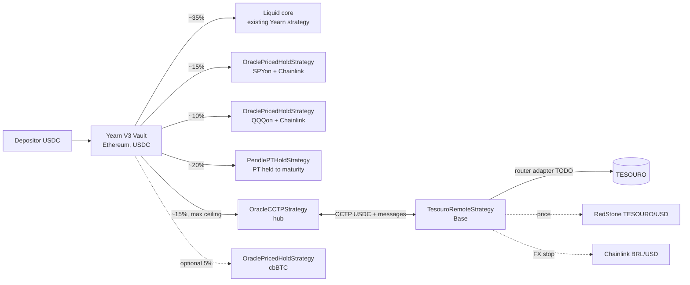
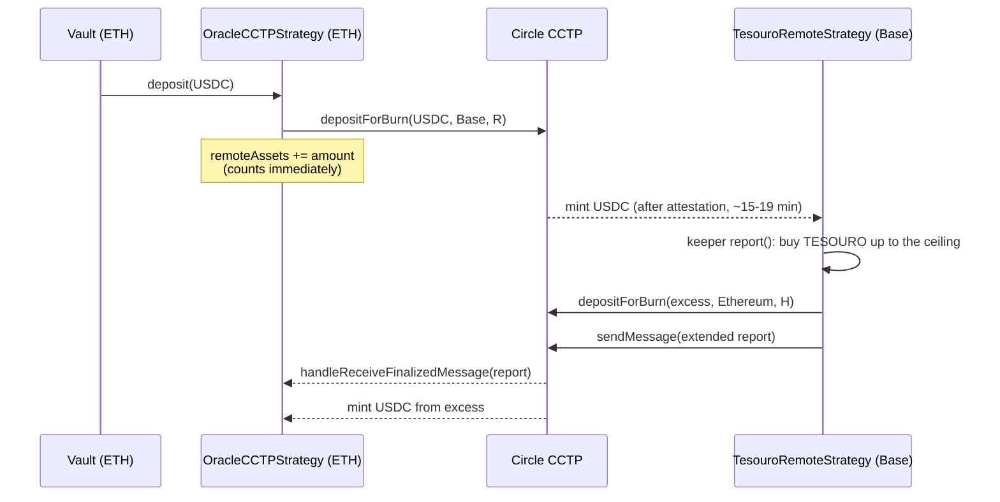
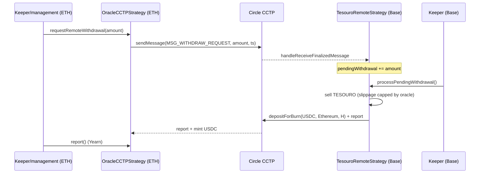

# USD hub on Ethereum with a TESOURO ceiling on Base

This document describes the `feat/usd-hub-tesouro-ceiling` branch. The idea is a Yearn V3 vault on Ethereum that takes **USDC**, similar to yvUSD, and splits funds across sleeves:

- **TESOURO on Base**, via CCTP, with a fixed USD ceiling;
- **SPYon and QQQon (Ondo)** on Ethereum itself;
- **a Pendle PT** held to maturity;
- **a liquid USD core** (an existing Yearn strategy, such as sUSDS or Morpho OG).

Nothing has been deployed. The scripts were only simulated (`forge script` without `--broadcast`).

## Architecture



| Contract | Network | What it does |
|---|---|---|
| `src/origin/OracleCCTPStrategy.sol` | Ethereum | Extends `CCTPStrategy`. Accepts the extended report, rejects stale reports, compares price against an optional hub oracle, sends withdrawal requests to Base, default 3% loss limit, hub-side exposure ceiling (`maxRemoteExposure`). |
| `src/remote/BaseOracleRemoteStrategy.sol` | Base | Base for remote sleeves that hold a priced asset (not ERC-4626). Swaps USDC for the asset via a router, values it with the oracle, sends the extended report, receives withdrawal requests from the hub. |
| `src/remote/TesouroRemoteStrategy.sol` | Base | TESOURO with a USD ceiling (`maxUsdExposure`, default 75,000 USDC) and a BRL/USD FX stop. |
| `src/remote/TesouroRemoteStrategyFactory.sol` | Base | CREATE3 deploy, same pattern as `RemoteStrategyFactory`, but governance-gated. |
| `src/local/OraclePricedHoldStrategy.sol` | Ethereum | Buys and holds a token (SPYon, QQQon, cbBTC) with USDC and values it from the feed, with a stale-price check. |
| `src/local/PendlePTHoldStrategy.sol` | Ethereum | Buys a PT with USDC and holds it to maturity, using Yearn periphery's `PendleSwapper` and Pendle's PY oracle. No loop and no borrow. |

The liquid core has no new code. It is an existing Yearn strategy added to the vault (`LIQUID_CORE_STRATEGY` in `DeployHub`).

Nothing here depends on "the hub is Ethereum, domain 0" beyond what the repo already assumed. The hub is Ethereum, so that still holds.

## Flows

### Deposit and bridge



### Extended report (Base → Ethereum)

The payload is `abi.encode(totalAssets, timestamp, price, oracleUpdatedAt)`, 128 bytes. The hub:

1. checks transmitter, domain, sender, and finality (same as the original `CCTPStrategy`);
2. rejects payloads that are not 128 bytes (the old 64-byte format is rejected on purpose);
3. rejects `price == 0`, `oracleUpdatedAt > timestamp`, `timestamp` older than `maxReportAge` (default 1 day), and `oracleUpdatedAt` older than `maxOracleAge` (default 26 h, because the RedStone feed has a 24 h heartbeat);
4. if `hubPriceOracle` is set, rejects when the difference exceeds `maxPriceDeviationBps` (default 2%);
5. applies the same timestamp watermark as the original repo.

On rejection the transaction reverts. The CCTP nonce is not consumed, and a newer report replaces the old one.

### Withdrawal request (Ethereum → Base)



While a request is pending, `report()` on Base does not buy TESOURO with the reserved USDC. Governance can clear the request with `clearPendingWithdrawal()`.

## USD ceiling

- `maxUsdExposure` is in USDC units (6 decimals). The default is `75_000e6` and governance can change it.
- Buys are capped at `maxUsdExposure - currentValue`. The amount bought is at most the USDC spent (because of slippage), so a buy never exceeds the ceiling.
- Idle USDC that does not fit under the ceiling is returned to the hub in `report()` and `tend()`. The same transaction sends a fresh report so the hub does not double-count.
- If price rises (or the ceiling is lowered) and the position exceeds `ceiling × (1 + ceilingBufferBps)` (default buffer 2%), `tendTrigger()` becomes `true` and `tend()` sells the excess and sends it back.
- On the hub, `setMaxRemoteExposure(ceiling)` limits `availableDepositLimit`, and `DeployHub` also sets the vault's `max_debt` to that value. So excess USDC never even goes to Base.
- With no router configured, the sleeve holds USDC up to the ceiling and returns the rest.

## FX stop

- `FX_ORACLE` is Chainlink BRL/USD on Base. With the zero address, the stop is disabled.
- `fxReferencePrice` is set at deploy. Governance can reset it with `resetFxReference()`.
- `fxStopTriggered()` is `true` when BRL/USD falls **more** than `fxStopBps` (default 10%) relative to the reference. If the feed is stale (older than `fxMaxStaleness`, default 2 h, since the heartbeat is 1 h), it returns `false`.
- Once the stop is triggered, **anyone** can call `fxUnwind()`. It sells TESOURO in chunks of up to `fxUnwindChunk` (the pool is thin), sends USDC to the hub, pushes the report, and sets `fxStopped = true`. After that the function stays callable until the sell is finished, even if FX recovers.
- With `fxStopped`, the sleeve buys nothing further and returns all incoming USDC. To return to normal, governance calls `resetFxStop()`, which also anchors the reference to the current price. Governance can also arm the stop manually with `setFxStopped(true)`.

## Roles, keepers, and relayer

| Role | Where | Does |
|---|---|---|
| Management (TokenizedStrategy) | Ethereum | Hub params (`setReportParams`, `setHubPriceOracle`, `setMaxRemoteExposure`, `setLossLimitRatio`) and local strategy params (router, slippage, staleness). |
| Keeper (TokenizedStrategy) | Ethereum | Strategy `report()`/`tend()`, `requestRemoteWithdrawal`. |
| Governance (remote) | Base | Ceiling, router, slippage, staleness, FX params, `resetFxStop`, `rescue`. |
| Keeper (remote) | Base | `report()`, `tend()`, `processWithdrawal`/`processPendingWithdrawal`, `pushFunds`/`pullFunds`. |
| Anyone | Base | `fxUnwind()`, only when the stop is triggered or already armed. |
| **Relayer** | both | **Not in the repo.** Someone must fetch the attestation from Circle's API (Iris) and call `MessageTransmitterV2.receiveMessage` on the destination chain, for both USDC mints and messages (report and withdrawal request). Without that, nothing arrives. It can be a custom bot or a CCTP relay service. |

## Suggested weights

| Sleeve | Target | Note |
|---|---|---|
| Liquid core (sUSDS / Morpho OG) | 35% | Pays withdrawals immediately, since CCTP takes 15–19 min per leg. |
| SPYon | 15% | |
| QQQon | 10% | |
| Pendle PT | 20% | Must not exceed what the market can take. Use `PT_MAX_DEBT`. |
| TESOURO (Base) | 15% | Capped by the USD ceiling. At a $75k ceiling it falls below 15% as the vault grows. |
| cbBTC (optional) | 5% | `CBBTC` + `CBBTC_USD_FEED`. |

These targets live in `script/DeployHub.s.sol` and are only applied if `DEBT_ALLOCATOR` is passed. For that, the broadcaster must be a manager of the allocator, and the vault must already be configured on it.

## Risks

- **BRL FX.** TESOURO yields in reais. A 10% drop in the real roughly eats a year of coupon. The stop limits the loss, but does not protect against a gap between two updates.
- **TESOURO liquidity on Base.** The Curve pool is about $73k, and supply on Base is around $24k (about 96k tokens at ~$0.25). That is why the ceiling, the `fxUnwind` chunks, and the 10% max slippage exist. A large exit can take several blocks or days.
- **Swap route unverified.** The intended path is Curve TESOURO/BRZ then BRZ→USDC, but no pool has been confirmed. The router is an `IOracleSwapRouter` adapter that **still needs to be written and audited**.
- **Single-source oracle.** TESOURO's price comes only from RedStone (push relayer, 0.1% deviation, 24 h heartbeat). The hub accepts a second oracle (`setHubPriceOracle`), but there is no TESOURO/USD feed on Ethereum today. A BRL/USD × TESOURO/BRL adapter can be built.
- **Equity market hours.** The SPYon/QQQon feeds are 24/5 with a 24 h heartbeat. Over the weekend the feed goes stale: deposits close, withdrawals are limited to idle USDC, and `report()` reverts. That prevents entering and exiting at a frozen price, but Monday's gap shows up all at once in the report.
- **Token restrictions.** Ondo Global Markets tokens have KYC/jurisdiction rules for mint/redeem and may have transfer locks. TESOURO (Etherfuse) also has issuer rules. Confirm that the vault and strategies are allowed to hold these tokens.
- **USDC = USD.** All valuation assumes 1 USDC = 1 USD.
- **PT.** `PendlePTHoldStrategy` assumes the SY's accounting asset is USD 1:1 with USDC and only accepts markets whose SY takes and returns USDC directly. Pendle's oracle needs enough cardinality for the TWAP (`getOracleState`).
- **Cross-chain accounting.** Same window as the original repo: between the USDC mint and the report arriving, the hub can count the same amount on both sides or on neither. The health check (10% profit, 3% loss) catches large distortions.
- **Unaudited code.** Tests are unit tests with mocks, plus fork checks of addresses only. There has been no integration test against live CCTP.

## Addresses

### Verified (on-chain via `cast` on 08/10/2026, plus the cited source)

| Item | Address | Source |
|---|---|---|
| TESOURO (Base), 6 decimals | `0x7ceE47e7B7CD04CF984e8Dd86C42595B5771A9B2` | `name()` = "Etherfuse TESOURO", `decimals()` = 6 |
| RedStone TESOURO/USD (Base), 8 decimals | `0xb67047eDF6204F4C81333248dA71F8387050790C` | `description()` = "RedStone Price Feed for TESOURO". redstone-oracles-monorepo `relayer-manifests-multi-feed/baseMultiFeed.json` (24 h heartbeat, 0.1% deviation). Note: the same address is the BTC feed on Katana. |
| Chainlink BRL/USD (Base), 8 decimals | `0x0b0E64c05083FdF9ED7C5D3d8262c4216eFc9394` | data.chain.link/feeds/base/base/brl-usd, `description()` = "BRL / USD", 1 h heartbeat |
| SPYon (Ethereum), 18 decimals | `0xFeDC5f4a6c38211c1338aa411018DFAf26612c08` | `name()` = "SPDR S&P 500 ETF (Ondo Tokenized)" |
| QQQon (Ethereum), 18 decimals | `0x0e397938C1Aa0680954093495B70A9F5e2249aBa` | `name()` = "Invesco QQQ (Ondo Tokenized)" |
| Chainlink SPYon/USD (Ondo API) | `0x6EcC1b902dB35eAFE95332443802774Fd1D72576` | Chainlink feed directory (`spyon-usd-shared-svr`), 24/5, 24 h heartbeat |
| Chainlink QQQon/USD (Ondo API) | `0xE5DF423251c67D85B2D70787Af76069d96BC4D4C` | Chainlink feed directory (`qqqon-usd-shared-svr`), 24/5, 24 h heartbeat |
| Pendle Router V4 | `0x888888888889758F76e7103c6CbF23ABbF58F946` | pendle-core-v2-public `deployments/1-core.json` |
| Pendle pyYtLpOracle | `0x5542be50420E88dd7D5B4a3D488FA6ED82F6DAc2` | pendle-core-v2-public `deployments/1-core.json` |
| Yearn VaultFactory 3.0.4 | `0x770D0d1Fb036483Ed4AbB6d53c1C88fb277D812F` | `TokenizedStrategy.FACTORY()`, `apiVersion()` = "3.0.4" |
| CCTP, USDC, domains | `src/libraries/CCTPHelpers.sol` | already in the repo |

All of these live in `src/libraries/TesouroAddresses.sol`. Contracts take everything as constructor args, and the scripts use these values as defaults that can be overridden via env.

### TODO / placeholders

| What | Where | Status |
|---|---|---|
| TESOURO↔USDC router on Base | `TESOURO_SWAP_ROUTER` / `setRouter` | **Does not exist.** Needs an `IOracleSwapRouter` adapter for Curve TESOURO/BRZ and BRZ→USDC. With zero, the sleeve holds USDC. |
| Equity router on Ethereum | `EQUITY_ROUTER` / `setRouter` | **Does not exist.** Uniswap adapter or Ondo mint/redeem. With zero, holds USDC. |
| PT market | `PENDLE_MARKET` | Pick a market whose SY accepts USDC directly and that is USD-denominated. Without it, the PT sleeve is skipped. |
| Liquid core strategy | `LIQUID_CORE_STRATEGY` | Address of an existing Yearn strategy (sUSDS / Morpho OG). |
| Hub TESOURO/USD oracle | `setHubPriceOracle` | Optional. Does not exist on Ethereum, so an adapter is needed. |
| cbBTC + feed | `CBBTC`, `CBBTC_USD_FEED` | Optional. |
| Debt allocator | `DEBT_ALLOCATOR` | Optional. Without it, weights are set by hand. |
| Roles | `SENDER`, `MANAGEMENT`, `KEEPER`, `EMERGENCY_ADMIN`, `PERFORMANCE_FEE_RECIPIENT`, `ROLE_MANAGER`, `REMOTE_GOVERNANCE`, `REMOTE_KEEPER` | Fill in. |
| CCTP relayer | — | Needs to be built (see above). |

## Deploy (not run yet)

1. **Base:** `forge script script/DeployRemoteBase.s.sol --sig "deployFactory()" --rpc-url $BASE_RPC_URL --broadcast` (env `REMOTE_GOVERNANCE`).
2. **Ethereum:** `forge script script/DeployHub.s.sol --rpc-url $ETH_RPC_URL --broadcast` with `TESOURO_REMOTE_FACTORY` equal to the address from step 1. The script predicts the hub address from the `SENDER` nonce and the remote strategy address from the CREATE3 salt `(TESOURO, 0, hub)`.
3. **Base:** `forge script script/DeployRemoteBase.s.sol --rpc-url $BASE_RPC_URL --broadcast` with `HUB_STRATEGY`, with the factory governance as broadcaster. The script checks that the address matches the prediction.
4. Accept management (`acceptManagement`) and the vault role manager, configure the relayer, and only then raise the vault `deposit_limit` (the script leaves it at 0 by default).

## Tests

```sh
# unit only (mocks, no RPC)
forge test --match-path 'src/test/unit/*'

# fork address checks (skip without RPC)
ETH_RPC_URL=... BASE_RPC_URL=... forge test --match-path 'src/test/fork/*'
```

What the unit tests cover: the ceiling (over-ceiling deposit returns to hub, second deposit returns in full, tend trim, no router), extended report accepted and decoded, old payload rejected, stale report and stale price rejected, price deviation, invalid sender/domain/finality on both sides, withdrawal request round-trip, `fxUnwind` only after the threshold (including with a stale feed and in chunks), configurable loss limit, and local strategy valuation with revert on stale price and PT held to maturity.
